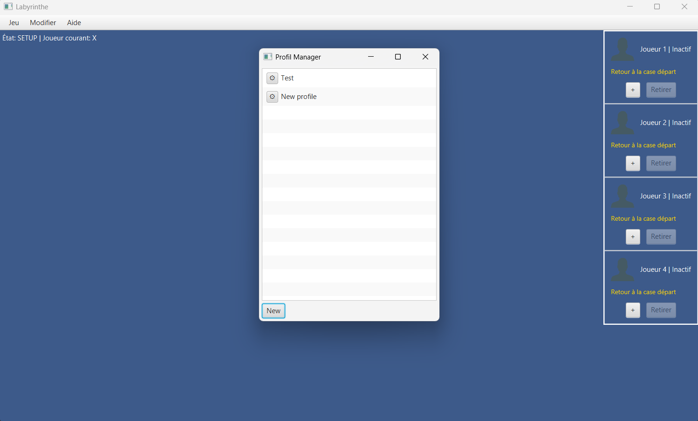
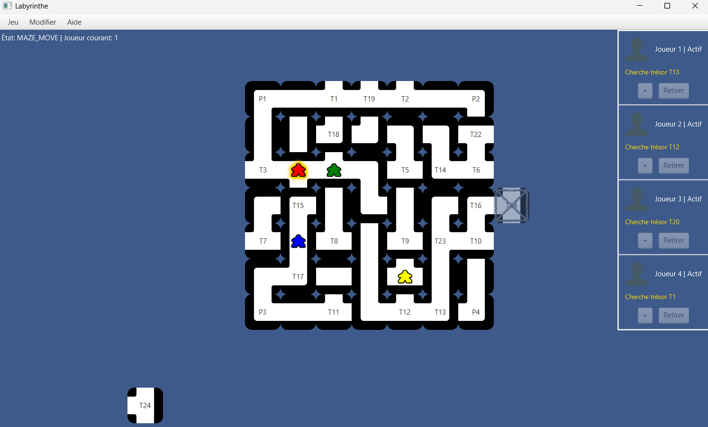

# Labyrinthe

Implémentation du jeu de société "Labyrinthe" en Java, avec une interface graphique JavaFX, un mode multijoueur local 
et la possibilité de joueur contre des bots.

## Fonctionnalités implémentées

- Plateau 7x7 avec tuiles mélangées aléatoirement
- 2 à 4 joueurs (humains ou bots)
- Tour par tour : insertion d'une tuile puis déplacement du pion
- Objectif : collecter tous ses trésors dans l'ordre, puis revenir à sa case de départ
- Bot avec stratégie Monte-Carlo
- Sauvegarde automatique entre chaque tour (SQLite)
- Sauvegarde/chargement manuel de parties au format JSON
- Gestion de profils de joueurs persistants

## Images du jeu



## Outils utilisés

- Java 21
- JavaFX
- SQLite (via JDBC)
- Gson

## Structure

```
src/
└── labyrinth/
    ├── model/              # logique du jeu
    │   └── strategy/       # IA (stratégie Monte-Carlo)
    │       └── simulation/ # moteur de jeu pour le bot
    ├── service/            # conteneur des services
    │   ├── dialog/         # service de dialogue (messages, fichiers, profils)
    │   ├── persistence/    # accès base de données SQLite (parties et profils)
    │   └── serialization/  # sérialisation JSON via Gson (DTOs + adaptateurs)
    ├── view/               # vues JavaFX
    ├── viewmodel/          # modèles de vue (pattern MVVM)
    └── util/
        ├── adapter/        # pont observables <-> JavaFX
        ├── collection/     # structures de données génériques (Grid, Position)
        ├── graph/          # graphe générique + BFS + adaptateur Maze -> Graph
        └── observable/     # système d'observables indépendant de JavaFX
```

## Architecture

Le projet suit le pattern MVVM. Le modèle est indépendant de JavaFX et expose ses états via des valeurs observables.
Les modèles de vues adaptent ces observables vers JavaFX avec `FxAdapter`.

Dans le moteur de simulation (`GameSimulation`), le bot explore les coups possibles sans modifier l'état réel de la partie.
Il cherche quel coup sera le meilleur parmi la majorité des coups possibles. Sa stratégie est simplement de se rapprocher
le plus possible du trésor qu'il doit atteindre, en créant un chemin accessible.

## Prérequis

- Java 21 ou supérieur (JDK ou JRE)
- JavaFX SDK 21 ou supérieur, à télécharger séparément : [gluonhq.com/products/javafx](https://gluonhq.com/products/javafx/)
- `labyrinth.jar`, disponible dans l'onglet [Releases](https://github.com/andreavltn/labyrinth/releases)

SQLite (JDBC) et Gson sont déjà inclus dans le `.jar`, rien d'autre à installer.

## Lancement

1. Télécharger `labyrinth.jar` depuis les [Releases](https://github.com/andreavltn/labyrinth/releases).
2. Télécharger et dézipper le SDK JavaFX.
3. Ouvrir un terminal **dans le dossier contenant `labyrinth.jar`**, puis exécuter :

**Windows**

```powershell
java --module-path "C:\chemin\vers\javafx-sdk-21\lib" --add-modules javafx.controls,javafx.fxml -jar labyrinth.jar
```

**Linux / macOS**

```bash
java --module-path /chemin/vers/javafx-sdk-21/lib --add-modules javafx.controls,javafx.fxml -jar labyrinth.jar
```

> Remplacer le chemin par celui du dossier `lib` de votre installation de JavaFX.

## Sauvegarde et persistance

- Au premier lancement, un fichier `labyrinth.db` est créé **dans le dossier depuis lequel la commande est exécutée**. Il contient la partie en cours et les profils des joueurs.
- Si le jeu est fermé puis relancé depuis le même dossier, la partie reprend là où elle s'était arrêtée.
- Pour une sauvegarde manuelle, enregistrer le fichier avec l'extension `.json`.
